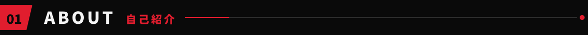
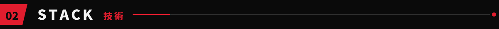
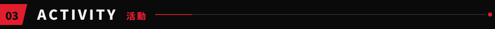

 

  

 

 

I build full-stack web apps, interactive 3D on the web, and machine learning projects. React, Next.js and Node on one side, Django and FastAPI on the other, with PyTorch and Three.js whenever a project gets fun.

| | |
|:--|:--|
| **Name** | Ayush Tandon |
| **Alias** | TheKizuya |
| **Class** | Full-stack developer |
| **Weapons** | TypeScript, Python, C++ |
| **Specialty** | Three.js, machine learning, web apps |

 

 

**Languages** 

**Frontend and 3D** 

**Backend** 

**Databases** 

**Machine learning and data** 

**Cloud and tools** 

 

 

<!--
  CONTRIBUTION SNAKE (optional)
  1. Add .github/workflows/snake.yml from this bundle and run it once from the Actions tab.
  2. When the 'output' branch exists, delete this comment wrapper so the image below shows.

  

-->

  
  

  

 

